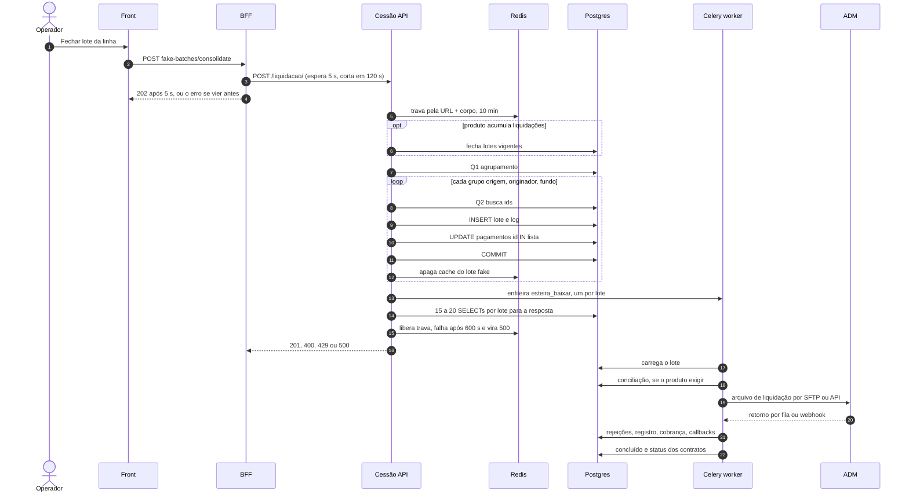
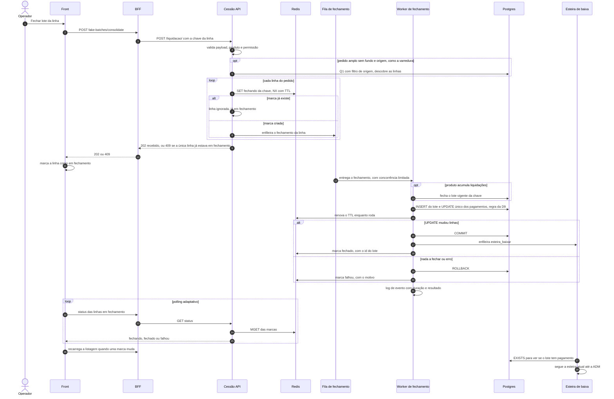

# 03 — Análise do fechamento de lote (`POST /liquidacao/`)

Base da [tarefa 03](03-fechamento-assincrono-e-429.md). Data: 09/10/2026.

- **Código:** platform-cessao `origin/master` `6bb61114e` (as linhas citadas
  são as mesmas da branch local). BFF e front: `master`.
- **Produção:** Datadog, 30 dias até 09/10
  ([evidência](../evidencias/fechamento-lote-datadog-2026-10-09.md)). As
  contagens de spans (trechos cronometrados de uma requisição) são amostradas e
  valem como piso.
- **Legenda:** **[C]** comprovado no código ou no Datadog; **[H]** hipótese a
  validar, com o caminho para validar.

## Resumo

- O fechamento demora por **espera de banco** em duas consultas (o
  agrupamento e a busca de ids) e na montagem da resposta. Python, Redis e
  Celery somam milissegundos. [C]
- A parte lenta **é o próprio fechamento**. A esteira (envio à ADM) já roda no
  Celery. Tornar a rota assíncrona sem otimizar só muda a demora de lugar. [C]
- As duas consultas **não usam a mesma regra** para decidir que pagamento
  entra no lote. Juntá-las exige uma decisão de negócio (D9). [C]
- **Correções da análise anterior:**
  - os ~20 fechamentos simultâneos de 08/10 vieram **da tela** (BFF), não da
    varredura nem do Atlas;
  - o Atlas manda os 4 campos (um grupo só) e não lê a lista de lotes da
    resposta;
  - a atualização de status dos contratos **não faz parte do fechamento**: é o
    último passo da esteira, depois que a ADM confirma.

## 1. Estimativa revisada

Horas no mesmo critério da [estimativa.md](../estimativa.md): **Dev** = código
e testes; **Val** = validação em ambiente, liberação e acompanhamento. Os itens
(P1, P2...) são detalhados na seção 8.

### Essenciais

| Etapa | Itens | Dev | Val | Total | Depende de | Risco |
|---|---|---|---|---|---|---|
| 0. Levantamentos | L1 dono da varredura, L2 produtos por modo, L3 medir na réplica o UPDATE único com o maior grupo real, L4 decisão D9 | 6 | 0 | 6 | infra (L1), DBA (L3), negócio (L4) | sem L4, a etapa 2 não começa |
| 1. Ganhos rápidos | adiados em 13/10 (só mexem no legado; ver `depois-da-v2.md`) | 0 | 0 | 0 | — | — |
| 2. Fechar numa instrução | P5 regra única + UPDATE por grupo, P7 medição | 14 | 5 | 19 | D9 | médio: muda a regra de elegibilidade |
| 3. Clique sem espera e sem 429 | P8 **assíncrono** (D10, 09/10): fila dedicada, marca no Redis, endpoint de status, polling na tela, BFF | 28 | 7 | 35 | contrato com Rafael Frankl (varredura) | médio |
| **Total** | | **48** | **12** | **60** | | |

A estimativa anterior era 38 h. A diferença vem das etapas 1 e 2, que não
existiam, e do assíncrono escolhido na D10 (+20 h sobre o cenário síncrono).
P1, P3 e P4 (10 h) saíram em 13/10 para `depois-da-v2.md`, porque a
TS-5377 segue o `refact.py` e não mexe no legado. O P2 (6 h) foi cortado em 13/10: a rota passa a devolver 202 e ninguém lê a
resposta atual. Os índices (P6, 12 h) saíram em 13/10 e foram para
[depois-da-v2.md](../depois-da-v2.md).

### Opcionais (fora do total)

| Item | Dev | Val | Total | Por que é opcional |
|---|---|---|---|---|
| O1 estado `excluindo` na exclusão | 8 | 3 | 11 | o `DELETE` já enfileira a exclusão; p95 12,5 s e nenhum caso acima de 600 s |
| O2 rota em lote (D6) | 6 | 2 | 8 | a tela fecha uma linha por vez |
| O3 status dos contratos em lote + corrida | 8 | 4 | 12 | fora do fechamento; 36 h de banco em 30 dias e um bug provável (seção 5) |
| O4 esteira: `fundo` uma vez por lote, N+1 dos geradores Genius/BGT | 16 | 8 | 24 | mexe no arquivo enviado à ADM; exige comparar arquivo antes/depois |
| O5 `liberacao_processos` dentro da esteira de baixa | 4 | 0 | 4 | só levantamento: entender por que a baixa roda a cessão do produto inteiro |
| **Total opcional** | **42** | **17** | **59** | |

## 2. As duas consultas

### Onde estão

| | Q1 — agrupamento | Q2 — busca de ids |
|---|---|---|
| Código | `LiquidacaoLoteProcesso.groups_pagamentos_aptos`, `cessao/database/models.py:6094-6124` | `pagamentos_query` em `LiquidacaoLoteProcesso.create_by_originador`, `models.py:6041-6058` |
| Pergunta que responde | "Quais lotes existem para fechar?" — agrupa os pagamentos sem lote por (origem, originador, fundo) | "Quais pagamentos entram neste lote?" — devolve os ids de um grupo |
| O que vem depois | um passo do loop por grupo | `UPDATE ... WHERE id IN (:ids)` (`create_update_lote_query`, `models.py:6380-6397`) |
| Custo em 30 dias [C] | 256 h de banco; p95 de 5,6 min (sem fundo) e 6,5 min (com fundo) | 501 h de banco; p95 de 8,1 min; até 510 mil ids numa execução |

Q1 só é chamada por `create_by_originador` (`models.py:6037`). Q2 roda uma vez
por grupo devolvido pela Q1.

### Quando executam: três caminhos

| Caminho | Gatilho | Como chama | Código |
|---|---|---|---|
| **A. Rota manual** | `POST /liquidacao/`: tela (BFF), Atlas e a varredura | com os campos do payload; `fundo_id` e origem são opcionais | `cessao/api/liquidacao/viewer.py:373-401` |
| **B. Automático por pagamento** | cada pagamento que chega a `cadastrado`, se `produto_config.lote_liquidacao` | **legado** (`fechar_lote_por_proc_id` desligado): quando a remessa não tem pagamento em andamento, uma vez **por originador, sem fundo, origem nem proc_id**; **portão** (ligado): por originador **com** proc_id | `framework/liquidacao/estados_liquidacao.py:341-346`; `models.py:5499-5516` e `5407-5417` |
| **C. Agendado** | beat diário às 19h UTC (16h em Brasília), produtos com `baixa_por_agendamento` | legado: GROUP BY próprio e uma chamada por (originador, origem, fundo); proc_id: `backstop_por_proc_id` | `cessao/schedule/registro.py:50-53`; `tasks/liquidacao_lote.py:240-300` |

O beat é o agendador do Celery: dispara tarefas em horário fixo.

### Problemas

**Comprovados [C]:**

1. **Q1 não filtra a origem**, mesmo quando o pedido traz uma. O loop roda a
   Q2 de **todas** as origens e só depois descarta as outras
   (`models.py:6060`).
   - Num fechamento de 1h42 (trace `2094615131271245462`), 13 das 14 Q2 eram
     de origens descartadas: 57% do tempo.
   - É também a fonte do aviso "Tentativa de criar lote sem pagamentos": 22.447
     em 30 dias.
2. **Q2 traz os ids para o Python e o UPDATE os devolve** (ver seção 5).
3. **Corrida no caminho B legado:** cada pagamento que fecha a remessa dispara
   o fechamento do originador inteiro, e os workers disputam os mesmos
   pagamentos.
   - O aviso "Corrida detectada" teve 115.226 ocorrências em 30 dias, sendo
     107.487 em 13/09, no originador 1513 / fundo 26.
   - O [baseline de 05/10](../evidencias/baseline-datadog-2026-10-05.md)
     contou 3.939 com outra busca. Vale reconferir a consulta, mas a ordem de
     grandeza já mostra o desperdício.

**Divergência de regra [C]**

Quatro pontos do sistema decidem se um pagamento "pode entrar em lote", e
não usam o mesmo critério:

| Critério | Listagem fake (tela) | Q1 — agrupamento | Q2 — busca de ids | Acúmulo (lote vigente) |
|---|---|---|---|---|
| Código | `repository.py:860-993` | `models.py:6094-6124` | `models.py:6041-6058` | `repository.py:459-473` |
| Produto | da liquidação | da **liquidação** | da **cessão do contrato** (efeito do `filter_by` logo após o join; confirmado no SQL do APM) | da liquidação |
| Liquidação em `cadastrado` | conforme o filtro da tela | sim | sim | entra no momento em que vira `cadastrado` |
| Cessão do contrato em `cadastrado` | não exige | **exige** | **não exige** | não exige |
| Contrato com processo excluído | fora | fora (`listeners.py:745-751`) | fora | — |

O GROUP BY próprio do agendado legado (`tasks/liquidacao_lote.py:276-292`)
não filtra estado nenhum, mas só descobre as combinações (originador, origem,
fundo). A decisão final passa pela Q1 e pela Q2, como nos outros caminhos.

O que significa cada estado:

- **Liquidação `cadastrado`** (`cessao/states/liquidacao.py`): o pagamento foi
  conciliado, passou nas regras, foi salvo e teve os callbacks executados. É o
  único estado que pode entrar em lote.
- **Cessão `cadastrado`** (`cessao/states/cessao.py`): a esteira de cessão
  terminou e o contrato foi cedido ao fundo. A conciliação da liquidação acha
  o contrato só pelo produto e pelo identificador, sem exigir cessão
  concluída. Então existe pagamento `cadastrado` de contrato com a cessão
  ainda em `liberando`, `registrando` etc.

**Regra que vale hoje em `create_by_originador`:** o pagamento entra se
passar na Q2 **e** o grupo dele tiver pelo menos um pagamento que passe na Q1.

Efeitos práticos:

- **Contrato com cessão não concluída:**
  - sozinho no grupo, o pagamento **não fecha**: aparece na tela, mas o
    fechamento devolve 400 (bug [B4](../bugs-encontrados.md));
  - acompanhado de um pagamento válido, ele **entra** no lote;
  - num produto que acumula, ele **entra sempre**, no lote vigente.
- **Produto:** quando o produto da liquidação é diferente do produto da
  cessão, a Q1 cria o grupo e a Q2 volta vazia. [H] Isso só deve acontecer em
  renegociação. Para medir, rodar na réplica:

  ```sql
  SELECT count(*)
    FROM liquidacao_pagamento lp
    JOIN liquidacao_processo pr ON pr.uuid = lp.liquidacao_processo_uuid
    JOIN contrato_parcela pa ON pa.id = lp.parcela_id
    JOIN contrato c ON c.id = pa.contrato_id
    JOIN contrato_processo pe ON pe.uuid = c.processo_uuid
   WHERE lp.liquidacao_lote_id IS NULL AND pr.produto_id <> pe.produto_id;
  ```

Para unificar, o negócio precisa dizer qual regra vale (**D9**), e a mesma
regra deve valer na listagem, no fechamento e no acúmulo.

**Decidido em 13/10 (Lukas Freyta, negócio):** a regra única **não exige a
cessão concluída** e usa o **produto da liquidação**. Ver as respostas abaixo.

### Perguntas para o negócio (D9)

Levar o número de casos, que se obtém rodando na réplica:

```sql
SELECT pe.estado_atual AS estado_da_cessao, count(*) AS pagamentos
  FROM liquidacao_pagamento lp
  JOIN liquidacao_processo pr ON pr.uuid = lp.liquidacao_processo_uuid
  JOIN contrato_parcela pa ON pa.id = lp.parcela_id
  JOIN contrato c ON c.id = pa.contrato_id
  JOIN contrato_processo pe ON pe.uuid = c.processo_uuid
 WHERE lp.liquidacao_lote_id IS NULL
   AND pr.estado_atual = 'cadastrado'
   AND pe.estado_atual <> 'cadastrado'
 GROUP BY 1 ORDER BY 2 DESC;
```

1. **Um pagamento pode ir para a ADM se a cessão do contrato ao fundo ainda
   não terminou?**
   - *Por quê:* hoje o agrupamento (Q1) exige a cessão concluída, mas a busca
     de ids (Q2) e o acúmulo não. A resposta define a regra única.
   - *Risco de negócio [H]:* liquidar um contrato que o fundo ainda não tem
     formalmente; a ADM pode recusar ou a conciliação pode não bater.
2. **Se não puder: ele espera a cessão terminar e entra no próximo lote?
   Existe prazo máximo, ou alguém precisa ser avisado?**
   - *Por quê:* se a cessão travar (erro, pendência de registro), o pagamento
     fica sem lote indefinidamente.
   - *Define:* se basta esperar ou se é preciso um alerta ou relatório de
     pagamentos parados.
3. **Vale igual para todos os produtos, inclusive os que acumulam
   liquidações?**
   - *Por quê:* no acúmulo, o pagamento entra no lote vigente no momento em
     que chega, sem olhar a cessão.
   - *Define:* se a regra também muda o acúmulo, e onde o pagamento fica
     enquanto espera. Também confirma se algum produto tem motivo para ser
     exceção.
4. **Na tela, esse pagamento aparece como "aguardando cessão" (sem poder
   fechar) ou fica escondido?**
   - *Por quê:* hoje ele aparece, o operador clica e recebe erro (B4).
   - *Troca:* mostrar dá transparência sobre o dinheiro parado; esconder tira
     ruído, mas o operador pode não saber que há pagamento pendente.
5. **Em renegociação, o pagamento pode ser de um produto diferente daquele em
   que o contrato foi cedido? Se puder, ele entra no lote de qual produto?**
   - *Por quê:* a Q1 usa o produto da liquidação e a Q2, o produto da cessão.
   - *Importa porque:* o produto do lote define fundo, ADM, layout do arquivo
     e conciliação.

### Respostas do negócio (Lukas Freyta, 13/10)

| # | Resposta | Consequência |
|---|---|---|
| 1 | O pagamento pode ir para a ADM antes de a cessão terminar | a regra única tira o filtro de cessão `cadastrado` da Q1. A listagem, o fechamento e o acúmulo passam a concordar, e o B4 deixa de existir |
| 2 | Se a cessão travar (não seguir), o pagamento deve ser **rejeitado** | **sem tratativa automática** (Pietro, 13/10): é caso extraordinário, tratado à mão |
| 3 | Vale para todos os produtos, inclusive os que acumulam | sem exceção por produto; o acúmulo segue a mesma regra |
| 4 | "Logs" | com a resposta 1, não existe mais pagamento "aguardando cessão" na tela; nada muda na listagem |
| 5 | Sempre o mesmo produto; liquidação e cessão deveriam ter o mesmo | usar o produto da liquidação. Divergência é anomalia de dados: medir com a consulta acima e logar se aparecer |

### Produtos e fluxos afetados

Qualquer mudança em Q1 ou Q2 afeta **os três caminhos** e, portanto, todo
produto que fecha lote, seja pela tela, pelo Atlas, pela varredura, no
automático ou no agendado.

- **Pela rota, segundo o Datadog [C]:**
  - tela e Atlas: produtos 1043, 713, 1901, 1145, 1143, 1274, 1241, 1637,
    1538, 449, 1802, 1703, 1571, 1505, 845, 1340, 1835 e 1769;
  - varredura: produtos 80, 4, 1406, 81, 581 e 15.
- **Pelo automático e pelo agendado:** os logs não trazem `produto_id`. O
  caminho certo é a configuração. Rodar na réplica (L2):

```sql
SELECT p.id, p.nome,
       pc.lote_liquidacao, pc.fechar_lote_por_proc_id, pc.liquidacao_automatico,
       pc.acumula_liquidacoes, pc.baixa_por_agendamento,
       CASE WHEN pc.lote_liquidacao IS NOT TRUE THEN 'sem fechamento automatico'
            WHEN pc.fechar_lote_por_proc_id THEN 'automatico por remessa (portao)'
            ELSE 'automatico legado (originador, todas as remessas)' END AS automatico,
       CASE WHEN pc.baixa_por_agendamento IS NOT TRUE THEN 'nao roda'
            WHEN pc.fechar_lote_por_proc_id THEN 'backstop por proc_id (16h)'
            ELSE 'legado sem filtro de estado (16h)' END AS agendado_16h
FROM produto p
LEFT JOIN produto_config pc ON pc.produto_id = p.id
ORDER BY automatico, agendado_16h, p.nome;
```

## 3. Síncrono e assíncrono

### Como é hoje [C]

- **Na cessão**, a rota é síncrona e roda até o fim: até 1h42.
- **Para o usuário**, ela já é quase assíncrona:
  - o BFF espera **5 s**. Se vier erro nesse tempo, mostra o erro; senão,
    devolve 202 ("em processamento") (`business.py:361-387`);
  - a chamada continua no BFF por até **120 s** e depois é cortada;
  - a cessão não percebe o corte e continua.
- **O que é lento** é buscar e marcar os pagamentos (Q1, Q2 e UPDATE) e montar
  a resposta. A esteira já é enfileirada no Celery (`service.py:365-380`).

Celery é o sistema de filas que roda tarefas em segundo plano, fora da
requisição.

### Por que se cogitou manter síncrono (histórico)

Decidido pelo assíncrono na D10 (09/10). Os argumentos a favor do síncrono
eram:

1. **Estado da tela vindo do banco:** a linha só sai da lista de lotes fake
   quando o UPDATE é gravado, sem marca à parte que possa divergir.
2. **Resposta verdadeira na hora:** "nada a fechar" e "já em fechamento"
   voltam no próprio clique.
3. **Menos peças:** sem fila nova, sem marca, sem polling.

O assíncrono venceu por escala e controle de carga no banco. Os pontos 1 e 2
foram cobertos pela marca no Redis com o resultado e pelo polling (abaixo).

### Divisão proposta

| Operação | Hoje | Síncrono (descartado) | Assíncrono (D10) |
|---|---|---|---|
| Validar payload, produto e permissão | requisição | requisição | requisição |
| Fechar lotes vigentes (acúmulo) | requisição | requisição (é um UPDATE de flag) | Celery |
| Q1 + INSERT + UPDATE | requisição | requisição | Celery, numa fila dedicada |
| Enfileirar a esteira | requisição | requisição | Celery |
| Resposta | 15–20 consultas por lote | uma consulta | 202 fixo |
| Esteira até a ADM | Celery | Celery | Celery |

**Decisão (D10, 09/10):** assíncrono total, com marca no Redis e polling na
tela. O critério original (p95 de um grupo em até 5 s → síncrono) foi
substituído pela escolha por escala e controle de carga. O P7 passa a
calibrar a concorrência da fila e o TTL da marca.

### Benefícios, riscos e consequências

| | Síncrono otimizado | Assíncrono total |
|---|---|---|
| Tempo da API | o do UPDATE (alvo: segundos) | milissegundos, sempre |
| Estado na tela | imediato, vem do banco | marca no Redis + polling: atraso de alguns segundos |
| Erro para o usuário | na hora (400/409) | validação na hora (400/403/409); erro do fechamento na linha, via marca `falhou`, até ela expirar |
| Clique repetido | o segundo recebe 409 | dedupe pela marca: o segundo recebe 409 e nada é enfileirado |
| Proteção do banco | depende de cada consulta ser barata | a fila limita quantas rodam juntas |
| Complexidade | baixa | fila, marca no Redis, endpoint de status, polling |
| Risco principal | grupo gigante estoura o tempo | worker morto sem gravar `falhou`: a linha volta a "fechável" sem mensagem |

### Controle do assíncrono: status da task ou marca no Redis

**Status da task no Celery: não recomendado.**

- Hoje o Celery da cessão **não guarda resultado** de task. A configuração é
  só o broker (`config/__init__.py:711-725`, `app_factory.py:60`), sem
  `result_backend`. Sem isso, toda consulta de status responde `PENDING`,
  até para um id que não existe. [C]
- Mesmo configurando, seria preciso guardar o id da task de cada linha da
  tela, e isso já é uma marca no Redis.
- Uma task morta (worker reiniciado) fica `STARTED` para sempre.
- Os fechamentos que não passam pela tela (automático, agendado, varredura)
  não teriam task para consultar.

**Marca no Redis por linha: viável.** É o mesmo padrão do portão do modo por
proc_id (`cessao/utils/lote_controle.py`).

1. No clique: `SET fechando:<chave da linha> NX EX <ttl>`. A chave da linha é
   a mesma da listagem fake (`_chave_do_lote_fake`, `repository.py:587`).
   - Se a chave já existe, responde 409.
2. A task renova o TTL enquanto roda e, no `finally`, troca a marca pelo
   resultado (`fechado` ou `falhou`), com TTL de alguns minutos.
3. A listagem fake lê as marcas das linhas da página (um `MGET`) e devolve
   "em fechamento" em cada linha.
4. O `WHERE liquidacao_lote_id IS NULL` do UPDATE continua sendo a proteção
   real contra fechar em dobro. A marca só serve para a tela.

Cuidados (os mesmos que derrubam a trava atual):

- **TTL menor que o fechamento:** a marca some no meio. A task renova o TTL,
  em vez de usar um valor fixo como os 600 s de hoje.
- **Worker morto:** a marca fica até o TTL. Por isso o TTL deve ser curto e
  renovado.
- **Redis no teto de memória:** com despejo de chaves (eviction), a marca pode
  sumir. Nesse caso a tela só perde a informação; não duplica lote.
- **Decisão de 06/10:** "estado da tela vem do banco, sem depender do Redis".
  Revisada em 09/10 pela D10, só para esta marca.

### Dedupe (não enfileirar o mesmo fechamento duas vezes)

O Celery não tem dedupe nativo; bibliotecas como `celery-once` fazem o mesmo
que a marca: uma trava no Redis. A marca com `SET NX` **já é o dedupe**, desde
que cubra três lacunas:

1. **Todos os caminhos passam pela marca.** Tela, agendado, varredura e
   automático fecham pela mesma task, que grava a marca da chave antes de
   fechar. Sem isso, a tela e o agendado podem fechar a mesma chave ao mesmo
   tempo.
2. **Pedido que cobre várias linhas vira uma task por linha.** A varredura
   manda só produto e originador, o que abrange várias chaves. A rota expande
   o pedido em grupos (Q1) e enfileira um por chave, cada um com a sua marca.
   Sem isso, chaves sobrepostas escapam do dedupe.
3. **Falha ao enfileirar desfaz a marca.** Se a publicação na fila falhar
   depois do `SET NX`, a rota apaga a marca. Se não apagar, a linha fica
   travada até o TTL.

A mesma mensagem entregue duas vezes pelo broker (worker que morre no meio)
continua protegida pelo `WHERE liquidacao_lote_id IS NULL`.

### Como a tela acompanha o fechamento (cenário assíncrono)

Polling adaptativo, ou seja, a tela pergunta de tempos em tempos se algo
mudou:

- **Endpoint leve de status:** recebe as chaves das linhas "em fechamento" e
  lê só as marcas no Redis (`MGET`). Não pode chamar a listagem inteira, que
  tem p95 de 94 s (lotes fake).
- **Intervalo curto** (alguns segundos) enquanto houver linha em fechamento.
  Sem nenhuma, só um intervalo longo ou o botão de atualizar.
- **Recarregar a listagem** só quando uma marca muda de estado.
- **Parar o polling** com a aba em segundo plano (Page Visibility API).
- **A marca carrega o resultado:** `fechando` → `fechado` (com o id do lote)
  ou `falhou` (com o motivo), e expira minutos depois. Assim o usuário vê
  "nada a fechar" ou o erro sem depender de log.

Com isso, o assíncrono dá feedback ao vivo e erros reais. Sobram três
limites:

- **Atraso:** o do intervalo do polling (segundos).
- **Resultado temporário:** depois que a marca expira, vale o que a listagem
  mostra (a linha fechou ou continua aberta). Erro antigo só no log.
  **Decidido em 09/10:** o motivo fica só na marca do Redis e no log
  (Datadog), como evento com a chave e o erro no `extra`. Foram descartados:
  uma tabela de pedidos, o `liquidacao_lote_log` (exigiria lote vazio, e as
  properties do lote quebram sem pagamento) e o `liquidacao_processo_log` (uma
  linha por processo a cada falha).
- **Worker morto à força:** o `finally` não roda e a marca expira sem
  `falhou`. A linha volta a "fechável" sem mensagem. Mitigar com alerta de
  task interrompida.

Alternativa descartada por ora: empurrar a atualização do servidor para a
tela (SSE ou WebSocket). Atualiza na hora, mas exige canal entre cessão, BFF
e front, além de cuidados com balanceador e vários pods. O ganho não compensa
para atualizações de segundos.

### Algo impede tudo assíncrono?

- **Técnico:** nada.
- **Negócio:**
  - nenhum impedimento comprovado: o BFF já devolve 202 e não lê o corpo, e o
    Atlas só lê o código e a mensagem;
  - **a varredura** (Rafael Frankl, Mercato Libero). Hoje ela recebe 400 em
    95% das chamadas. Antes de passar a devolver 202, combinar com ele.

## 4. Varredura e Atlas

### Atlas [C]

- **O que é:** API GraphQL da antiga Capitalis, que reúne vários serviços numa
  só. GraphQL é uma API em que o cliente pede, numa consulta, exatamente os
  campos que quer.
  - Código em `atlas/api-zeus`; no Datadog, `service:api-atlas`.
- **Onde fecha lote:**
  - mutation `closeLiquidation`
    (`atlas/api-zeus/atlas/cessao/resolvers/mut_close_liquidation.py:10-24`);
  - que chama `post_create_liquidation_batch` da biblioteca fetch-api
    (`fetch-api/fetch_api/cessao/cessao.py:225-227`).
- **Payload:** produto, originador, fundo e origem: um grupo.
- **Quem dispara:** usuário no navegador. Foram 381 chamadas em 30 dias.
- **Uso da resposta:** só código HTTP, status e mensagem
  (`atlas/commons/resolvers/global_objects.py:40-60`). A lista de lotes não é
  lida.

### Varredura [C, salvo indicação]

- **O que é:** uma automação **fora dos nossos repositórios**. Não está no EKS
  (o cluster Kubernetes de produção), não manda trace e não aparece no
  inventário do Datadog.
  - Chama de uma EC2 de automações, com `python-requests/2.31.0`.
  - A mesma máquina acessa o Postgres da cessão com um usuário de banco
    próprio.
- **Quando roda:** dias úteis, em 4 rodadas (16h, 17h, 18h e 20h em
  Brasília). Cada rodada são ~78 chamadas em sequência, de ~2 s cada.
- **Payload:** só produto e originador. São 6 produtos (80, 4, 1406, 81, 581
  e 15) × 13 originadores.
- **Resultado:** 3.447 chamadas em 30 dias:
  - 3.274 (95%) com 400 "nenhum pagamento apto";
  - 137 com 200;
  - 27 com 500.
- **Outras chamadas do mesmo IP:**
  - `PATCH /produto/<id>/` às 10h, inclusive no fim de semana;
  - `DELETE /liquidacao/pagamentos`;
  - `PATCH /liquidacao/`.
- **Dono (L1, respondido em 09/10):** Rafael Frankl, que roda os processos
  de liquidação do Mercato Libero, o maior cliente. [H] Os 6 produtos da
  varredura devem ser do Mercato Libero; confirmar com ele.
- **Conversa com ele:** pauta em
  [Conversa com o Rafael](#conversa-com-o-rafael-varredura); respostas em
  [Respostas do Rafael](#respostas-do-rafael-1310).

### Conversa com o Rafael (varredura)

**Contar a ele**

- A varredura fecha lotes 4 vezes por dia útil. Em 95% das chamadas não há o
  que fechar, mas cada chamada paga a busca completa no banco.
- Parte dos erros 500 da rota acontece com o lote **criado**: a trava expira
  aos 10 min e a resposta sai como erro.
- A rota vai mudar para assíncrona: responde "recebido" e o resultado é
  consultado depois.

**Perguntar**

1. **Para que serve a varredura?** Fechar o que sobrou antes de algum corte
   da ADM ou da conciliação?
   - *Por quê:* se for isso, o fechamento por horário de corte (tarefa 11)
     pode substituí-la.
2. **Por que nesses horários (16h, 17h, 18h e 20h)?**
   - *Por quê:* mostra se há um prazo de negócio que a tarefa 11 precisa
     respeitar.
3. **O que o script faz com a resposta?** Lê só o código HTTP ou também a
   lista de lotes (id, valor, quantidade)? Trata o 400 como normal? Tenta de
   novo no 500 ou no 429?
   - *Por quê:* a resposta vai passar a ser 202, sem lista. Se ele usa a
     lista, precisamos de uma alternativa.
   - Vale avisar: um 500 nem sempre é falha; o lote pode ter sido criado.
4. **Ele aceita o modelo assíncrono?** Enviar, receber "recebido" e consultar
   o resultado depois. Precisa do id do lote logo em seguida?
   - *Por quê:* define o desenho do endpoint de status para ele.
5. **Por que manda só produto e originador, sem fundo e origem?**
   - *Por quê:* o pedido amplo é o que mais custa. A rota vai quebrá-lo em
     uma linha por fundo e origem, e o resultado passa a vir por linha.
6. **Confirmar o escopo:** os produtos 80, 4, 1406, 81, 581 e 15 são do
   Mercato Libero? Os 13 originadores são fixos?
7. **As outras chamadas do mesmo script:**
   - `PATCH /produto/<id>/` todo dia às 10h, inclusive no fim de semana,
     gravando `padrao_liquidacao = json_padrao`. Por quê? Algo desfaz essa
     configuração?
   - `DELETE /liquidacao/pagamentos` (159 em 30 dias, 139 só em 08/10). Em que
     situação ele exclui pagamentos?
   - `PATCH /liquidacao/` (data de envio). Para quê?
   - Acesso direto ao Postgres com o usuário de banco dele: só leitura
     ou também grava? Em quais tabelas?
   - *Por quê:* mudanças da V2 (regra de elegibilidade, estados novos,
     réplica) podem quebrar algo que ele faz por fora.
8. **Onde roda e como identificar:**
   - Quem cuida da máquina?
   - Ele pode mandar um cabeçalho de identificação (`User-Agent` próprio)?
   - *Por quê:* para monitorar no Datadog e separar as chamadas dele das
     outras.
9. **Transição:**
   - Existe ambiente de homologação para ele testar o contrato novo?
   - Qual janela de mudança funciona para ele?
   - *Por quê:* é o processo de liquidação do maior cliente; a troca não pode
     ser no escuro.

### Respostas do Rafael (13/10)

| # | Resposta | Consequência |
|---|---|---|
| 1 | A varredura fecha os lotes do Mercato Libero, que têm uma entrada bem diferente dos outros produtos | a tarefa 11 não a substitui sem estudar essa entrada; a varredura continua |
| 2 | Não sabe o motivo dos horários; dá para reduzir | combinar menos rodadas (95% delas não acham nada) |
| 3 | O script não lê a resposta | a troca para 202 não o afeta; a etapa 3 está liberada do lado dele |
| 4 | Aceita o modelo assíncrono | idem |
| 5 | Vai passar a mandar fundo e origem (uma linha por chamada) | some o pedido amplo dele. A quebra por linha na rota fica como proteção para outros chamadores |
| 6 | Os produtos são 80, 4, 1406, 81, 581 e 15; não se sabe se os originadores são fixos | — |
| 7a | `PATCH /produto`: troca a configuração só para subir os dados e depois volta (processo legado) | [H] risco: durante a janela, outros fluxos do produto leem a configuração trocada |
| 7b | `DELETE /liquidacao/pagamentos`: quando a cessão engasga ou o contrato fica preso | extraordinário, segundo ele; sem tratativa na V2 |
| 7c | `PATCH /liquidacao/`: outro processo (Omnis) | fora do escopo |
| 7d | O usuário de banco dele **lê e grava** no banco | **em aberto:** quais tabelas e consultas. Mudanças de regra e de estado da V2 podem quebrar o que ele faz |
| 8 | A máquina é uma EC2 de projetos e automações | **em aberto:** `User-Agent` próprio para separar as chamadas no Datadog |
| 9 | Testes a alinhar depois | pendente |

### Como interagem com o fechamento

Os dois usam a **mesma rota e o mesmo código** da tela (caminho A).

- **O Atlas** manda um grupo, como a tela.
- **A varredura**, sem fundo e sem origem, faz a Q1 devolver **todos os
  grupos do originador**, com uma Q2 por grupo. Mesmo quando a resposta é
  "nada a fechar", ela paga a Q1 inteira, 4 vezes por dia, para 78
  combinações.

### Os ~20 fechamentos simultâneos de 08/10

- **Quem foi [C]:** ~20 POSTs do **BFF**, entre 12:33 e 13:17, no produto 713
  (originadores 523 e 1282, 5 origens cada).
- **Como acontece:**
  - [C] o front não tem seleção múltipla: é um clique por linha, com
    confirmação. Cada clique volta em 5 s com 202, mas a chamada segue no BFF
    por até 120 s e na cessão até terminar;
  - [H] o operador fechou várias linhas em sequência. Como as chaves eram
    diferentes, não houve 429.
- **Por que saturou:**
  - [C] consultas que começaram em momentos diferentes **terminaram no mesmo
    milissegundo**, em blocos;
  - [C] o banco mostrava ~140 sessões esperando LWLock e ~86 esperando disco.
    LWLock é a trava interna leve do Postgres, usada por exemplo para acessar
    páginas em memória. A métrica é do servidor inteiro, não só da cessão;
  - [C] havia uma transação aberta havia 48 min;
  - [H] cada fechamento lê grande parte de pagamentos, parcelas, contratos e
    processos. Vinte leituras pesadas ao mesmo tempo disputam disco e memória.
- **Como confirmar:** no próximo pico, amostrar o `pg_stat_activity` (colunas
  `wait_event_type` e `wait_event`) ou usar o DBM do Datadog, e rodar
  `EXPLAIN (ANALYZE, BUFFERS)` da Q1 na réplica.

### Limitar a concorrência no Celery

Só vale no cenário assíncrono.

- **Como funciona:** uma fila dedicada ao fechamento, com N processos (por
  exemplo, 2). Nunca rodam mais que N fechamentos juntos; os outros esperam na
  fila.
- **Ajuda:** protege o banco e as outras telas. [H] O tempo total dos 20 pode
  até cair, por haver menos disputa.
- **Não resolve:** cada fechamento continua lento, e o usuário espera na fila.
- **Conclusão:** é rede de segurança. Quem resolve é tornar cada fechamento
  barato (etapas 1 e 2).

**Como limitar: fila dedicada (decidido em 13/10)**

Hoje todo worker escuta todas as filas: o `entrypoint.sh` fixa a lista no
`-Q` e não lê o `CELERY_WORKER_QUEUES` que aparece no argocd. São 18 pods com
concorrência 16, ou 288 tarefas ao mesmo tempo. [C]

| | Fila dedicada (escolhida) | Semáforo no Redis (descartado) |
|---|---|---|
| Limite | físico: pods × concorrência | lógico; vaga presa se o worker morrer |
| Ordem | preservada | perdida nas novas tentativas |
| Espera | previsível | irregular (atraso de cada tentativa) |
| Isolamento | não disputa vaga com outras tarefas | disputa as 288 vagas |
| Visibilidade | tamanho da fila = atraso real | espalhada em novas tentativas |
| Custo | PR no argocd e um pod a mais | só código |

O que muda:

- **Cessão:** rota da task nova para a fila própria em `task_routes`
  (`app_factory.py:63-74`), e o `entrypoint.sh` aceita a lista de filas por
  uma variável **nova**, com a lista atual como padrão. Assim os pods de hoje
  não mudam e não escutam a fila nova. Não usar o `CELERY_WORKER_QUEUES`, que
  ativaria a configuração adormecida do argocd.
- **Argocd:** deployment novo só para a fila de fechamento (sandbox e
  produção), com concorrência baixa via `CELERY_WORKER_CONCURRENCY`.
- **Risco:** com 1 pod, se ele cair, os fechamentos esperam ele voltar; a
  marca expira e a linha volta a ficar clicável.

## 5. Fechar o grupo numa instrução (proposta B)

### Em que etapa acontece

Nos passos 6 a 9 do mapa da seção 7, dentro de `create_by_originador`. É a
mesma função nos três caminhos (rota, automático e agendado), então a melhoria
vale para todos.

### Como é hoje: exemplo

Pedido: produto 713, originador 1282, fundo 209, origem "X".

1. **Q1:** devolve 5 grupos, um por origem do originador nesse fundo, porque
   não filtra a origem "X".
2. Para cada um dos 5 grupos:
   1. **Q2:** busca os ids. O banco acha, por exemplo, 76.210 pagamentos e
      **envia os 76.210 ids ao Python**.
   2. Se a origem do grupo não é "X", **descarta** (a consulta já foi paga).
   3. `INSERT` do lote e da linha de log.
   4. `UPDATE liquidacao_pagamento SET liquidacao_lote_id = 9001 WHERE id IN
      (76.210 ids) AND liquidacao_lote_id IS NULL`: o Python **devolve os
      76.210 ids** ao banco.
   5. Se 0 linhas mudaram ("Corrida detectada"), desfaz (rollback). Senão,
      grava (commit) e limpa o cache do lote fake no Redis.

### Como fica

1. Q1 só se o pedido não trouxer origem e fundo (varredura). Se rodar, já
   filtra a origem (P1).
2. `INSERT` do lote.
3. Um UPDATE que procura e marca de uma vez:

   ```sql
   UPDATE liquidacao_pagamento lp
      SET liquidacao_lote_id = :lote_id, data_atualizacao = now()
     FROM liquidacao_processo pr, contrato_parcela pa, contrato c,
          contrato_processo pe
    WHERE lp.liquidacao_lote_id IS NULL
      AND pr.uuid = lp.liquidacao_processo_uuid AND pr.estado_atual = 'cadastrado'
      AND pa.id = lp.parcela_id AND c.id = pa.contrato_id
      AND pe.uuid = c.processo_uuid AND pe.data_delete IS NULL
      AND <regra da D9: produto e estado da cessão>
      AND c.originador_id = :originador_id AND pe.fundo_id = :fundo_id
      AND lp.origem_pagamento = :origem
   ```

4. Se 0 linhas mudaram, desfaz e grava `falhou` ("nada a fechar") na marca
   da linha. Senão, grava o lote e a marca `fechado`.

### Por que não trazer ids ao Python ajuda

- **Trabalho dobrado:** hoje o banco acha as linhas, manda, recebe de volta e
  acha de novo, uma a uma, pela chave.
- **Volume:** 76 mil a 510 mil ids atravessam a rede e ocupam memória do
  processo.
- **Instrução gigante:** um `IN` com 76 mil valores custa para montar e
  planejar. No trace `6ac7d5f100000000df4ac3ff62f4cfd8`, só o UPDATE levou
  85 s.
- **Corrida:** a janela entre o SELECT e o UPDATE é onde outro processo pega
  os mesmos pagamentos. Numa instrução só, essa janela some.

**Limite honesto:** o maior custo está em **achar** os pagamentos (Q2 chegou a
37 min). O UPDATE único não resolve isso sozinho. O P1 reduz o número de
buscas; acelerar cada busca depende de índice, que ficou para depois da V2
(seção 6). O UPDATE único elimina a segunda passada, o tráfego e a corrida.

### Impacto

- **Banco:** as linhas ficam travadas do UPDATE até o commit, como hoje, mas
  por menos tempo. O SQL escrito à mão não passa pelo filtro automático de
  exclusão do ORM, então o `pe.data_delete IS NULL` tem de estar explícito.
- **Aplicação:** `create_by_originador` mantém a assinatura; o modo por proc_id
  usa o mesmo desenho (tarefa 02).
- **Negócio:** **muda a regra** para os pagamentos de contratos com a cessão
  não concluída e para o caso de produto divergente (seção 2). Precisa da D9.

### E a atualização de status dos contratos?

**Não tem relação com o fechamento do grupo.** Foi um erro agrupá-la no item
B.

- **Onde:** é o último passo da esteira, quando o lote fica `concluido`
  (`framework/liquidacao/estados_baixa.py:78-88`), na tarefa
  `atualiza_status_contrato_task` (`tasks/liquidacao_lote.py:107-222`).
- **O que faz:** grava em `contrato_transacao` o marco "contrato liquidado" ou
  "cancelado", quando todas as parcelas foram pagas em lotes concluídos.
- **Quem usa esse marco:**
  - permitir ceder o título de novo (`conciliacao/conciliador.py:428`);
  - regras de duplicidade (`regras/cessao/contrato_duplicado.py`);
  - baixa no registro (`tasks/registro.py`).
- **Custo [C]:** 36 h de banco em 30 dias. Uma subconsulta `count()` por linha
  e um INSERT por contrato (3,1 milhões).
- **Bug provável [H]:** a tarefa é enfileirada **antes** do commit do estado
  `concluido` (`estados_baixa.py:86-87`). Se o worker for mais rápido, o
  contrato é descartado e nada tenta de novo.
  - Para validar: contar lotes `concluido` com contratos quitados sem
    `contrato_transacao` de liquidação.

Fica como opcional (O3), mas vale registrar o bug em
[bugs-encontrados.md](../bugs-encontrados.md).

## 6. Índices (adiado)

Decidido em 13/10: criar ou alterar índices fica para depois da V2. O
diagnóstico, os candidatos, os riscos e as consultas para medir estão em
[depois-da-v2.md](../depois-da-v2.md#índices-para-o-fechamento-de-lote).

Sem os índices, a busca dos pagamentos pendentes continua sendo o maior custo
do fechamento. O que a tarefa 03 reduz é o número de buscas (P1), a segunda
passada e o tráfego de ids (P5), e a concorrência no banco (fila da D10).

## 7. Mapa do `POST /liquidacao/`

Os dois fluxos em sequência: primeiro como é hoje (as-is), depois como fica
(to-be). O passo a passo detalhado do as-is vem em seguida.

### Como é hoje (as-is)



### Como fica (to-be)

Com as decisões até 13/10: D10 (assíncrono), dedupe pela marca, pedido amplo
quebrado por linha, P1, P4, P5 e P7. Os itens pendentes aparecem marcados
(regra da D9; contrato com o Rafael).



**O que muda em relação ao as-is**

| Passo do as-is | Como fica | Item |
|---|---|---|
| 1. Marca "em andamento" em memória no front | marca no Redis, lida por polling; vale para outras abas e usuários | P8 |
| 2. BFF espera 5 s e segura a chamada até 120 s | repassa e devolve na hora (202, 409, 400, 403) | P8 |
| 3. Trava `@max_calls` (429 e 500 aos 600 s) | sai; o dedupe é a marca com `SET NX` | P8 |
| 5. Q1 sem filtro de origem | só roda em pedido amplo e já filtra a origem | P1 |
| 6 a 8. Q2 traz ids ao Python e o UPDATE os devolve | um UPDATE que procura e marca de uma vez, no worker | P5 |
| 11. Resposta com 15 a 20 consultas por lote | 202 sem lista; o resultado vem pela marca | P8 |
| 12. `lote.pagamentos` só para testar se está vazio | `EXISTS` | P4 |
| — | log de evento por fechamento (duração e quantidade) | P7 |

**O que continua igual**

- **Automático (caminho B) e agendado (caminho C):** continuam chamando
  `create_by_originador` direto, já com P1 e P5. Passam a usar a mesma task e
  a marca quando a tarefa 11 os reescrever.
- **Esteira depois do lote:** passos 13 a 17 sem mudança. Os opcionais O3 e
  O4 e os bugs B6 a B8 não entram neste desenho.

### Passo a passo do as-is

**Na requisição (síncrono)**

1. **Clique na tela**
   - **Negócio:** o operador manda fechar os pagamentos prontos de uma linha
     (produto, originador, fundo, origem).
   - **Técnico:** `consolidateBatch`, `close-batches.ts:569-620` (front), com
     confirmação. A marca "em andamento" fica num `Map` em memória
     (`:113`, `:547-551`).
   - **Performance:** a marca some ao recarregar a página, o que abre espaço
     para o clique repetido.
2. **BFF**
   - **Negócio:** confere a permissão e repassa o pedido.
   - **Técnico:** `liquidation_batches/viewer.py:324-358` (papéis
     `liquidation-fake-batches:update` ou `admin:update`);
     `business.py:330-387`.
   - **Performance:** devolve 202 após 5 s, mas mantém a chamada por até
     120 s. Não confere se o produto é do parceiro (B5).
3. **Trava**
   - **Negócio:** impedir o mesmo fechamento em dobro.
   - **Técnico:** `@max_calls(release_time=600)`,
     `cessao/cache/decorators.py:25-55`, com chave URL + corpo no Redis.
   - **Performance:** devolve 429 ao clique repetido. Passados 600 s, o
     `release()` falha e a resposta vira 500, mesmo com o lote criado (49 dos
     71 erros 500).
4. **Produto e acúmulo**
   - **Negócio:** se o produto acumula liquidações, fecha o lote que estava
     aberto (vigente).
   - **Técnico:** `viewer.py:379-389`; `service.py:1165-1185`;
     `repository.py:476-494`.
   - **Performance:** barato. Um commit por lote vigente.
5. **Q1 — agrupamento**
   - **Negócio:** descobrir quais lotes existem.
   - **Técnico:** `models.py:6094-6124`.
   - **Performance:** 256 h em 30 dias. Ignora a origem pedida.
6. **Q2 — busca de ids, por grupo**
   - **Negócio:** escolher os pagamentos do lote.
   - **Técnico:** `models.py:6041-6058`; o descarte por origem fica em `:6060`.
   - **Performance:** 501 h em 30 dias. Ids vão ao Python. Roda também para os
     grupos descartados.
7. **Criar o lote**
   - **Negócio:** nasce o lote real, em `pendente`.
   - **Técnico:** `models.py:6066-6070`. O estado inicial e a linha de log vêm
     do `FluxoMixin` (`models.py:428-598`).
   - **Performance:** barato.
8. **Ligar os pagamentos ao lote**
   - **Negócio:** os pagamentos saem da lista de fake e passam a ser do lote.
   - **Técnico:** `models.py:6072-6085`, com o guard "0 linhas → descarta".
   - **Performance:** `IN` de até 76 mil ids (até 5 min). É o ponto da
     corrida.
9. **Cache do lote fake**
   - **Negócio:** nenhum leitor conhecido; fica até o Atlas sair (decisão de
     06/10).
   - **Técnico:** `listeners.py:203-224`.
   - **Performance:** ~3 ms.
10. **Enfileirar a esteira**
    - **Negócio:** mandar o lote seguir para a ADM.
    - **Técnico:** `service.py:365-380`, com `esteira_baixar.apply_async`.
    - **Performance:** de 0,5 a 22 ms.
11. **Resposta**
    - **Negócio:** devolver os lotes criados. Só o código e a mensagem são
      lidos pelo BFF e pelo Atlas.
    - **Técnico:** `schemaLoteLiquidacao`, `schema.py:57-79`. Cada campo é
      uma property que consulta o banco (`models.py:5779-5925`).
    - **Performance:** 15 a 20 consultas por lote. Num caso real levou 14 min
      (99% da requisição).

**No worker (assíncrono)**

12. **Início da esteira**
    - **Negócio:** pegar o lote para processar.
    - **Técnico:** `tasks/liquidacao_lote.py:82-104`.
    - **Performance:** `lote.pagamentos` carrega o lote inteiro só para ver se
      está vazio (610 mil linhas em 5,7 min).
13. **Conciliação**
    - **Negócio:** conferir o saldo da conta do fundo antes de enviar; o lote
      pode parar para revisão manual.
    - **Técnico:** `framework/liquidacao/baixar.py:78`; corte em
      `tasks/conciliacao_liquidacao.py:190`; saldo por HTTP em
      `framework/regras/conciliacao/saldo.py:22`.
    - **Performance:** pausa de negócio, não de banco. `lote.fundo` é
      consultado de novo para cada lote.
14. **Arquivo e envio à ADM**
    - **Negócio:** gerar o CNAB ou CSV e enviar.
    - **Técnico:** `emissores/liquidacao.py:103`; geradores em
      `geradores/cnab_500_liquidacao_genius.py` e
      `geradores/csv_liquidacao_bgt.py`.
    - **Performance:** de 5 a 7 consultas por pagamento (N+1: uma consulta para
      cada linha de um laço). `fundo` é consultado várias vezes.
15. **Retorno da ADM**
    - **Negócio:** aplicar o aceite ou a recusa de cada pagamento.
    - **Técnico:** Genius em `consumer/callbacks/liquidacao.py:112`; BGT e
      outras em `api/callback/service.py:570`.
    - **Performance:** carrega todos os pagamentos. Um DELETE por pagamento
      recusado.
16. **Registro, cobrança e callbacks**
    - **Negócio:** baixar o registro e avisar os sistemas dos parceiros.
    - **Técnico:** `estados_baixa.py:91-181`.
    - **Performance:** a etapa `liberacao_processos` (`:94-106`) roda a cessão
      de **todos** os contratos do produto em `liberando`, sem relação com o
      lote. [H] Há também possível laço sem pausa em `EstadoBaixandoRegistro`
      (`:151-166`).
17. **Conclusão**
    - **Negócio:** fechar o ciclo e marcar os contratos quitados.
    - **Técnico:** `estados_baixa.py:78-88`; `tasks/liquidacao_lote.py:107-222`.
    - **Performance:** 36 h em 30 dias. [H] Corrida entre o enfileiramento e o
      commit.

**Dependências e concorrência**

- Os passos 5 a 8 são **em série, por grupo**, cada grupo com seu commit.
- A resposta (11) roda **ao mesmo tempo** que o worker (12), sobre o mesmo
  lote. No trace `4019562183569338825`, as duas consultas terminaram no mesmo
  milissegundo.
- Os passos 5 a 8 rodam também no **automático** (caminho B, a cada
  pagamento) e no **agendado** (C). Eles disputam os mesmos pagamentos com a
  tela.

## 8. Proposta consolidada

Princípio: **primeiro deixar cada fechamento barato; depois tirá-lo da
requisição** (assíncrono, D10).

| # | Item | Justificativa | Impacto no negócio | Risco | Esforço |
|---|---|---|---|---|---|
| L1–L4 | Levantamentos | sem eles não dá para mudar regra nem contrato | D9 define quais pagamentos entram em lote | — | 6 h |
| **P1** | Q1 recebe a origem | 57% de um caso real; custo cresce com o quadrado do número de origens | nenhum: o resultado é o mesmo | baixo | 5 h |
| ~~P2~~ | ~~Resposta numa consulta~~ | cortado em 13/10: a rota passa a devolver 202 e ninguém lê a resposta (BFF, Atlas e varredura) | — | — | 0 h |
| **P3** | Trava expirada não vira 500 | 49 dos 71 erros 500, inclusive com o lote criado | o operador para de ver erro em fechamento que deu certo | baixo. Na etapa 3 o `@max_calls` sai desta rota; o P3 continua valendo para as outras 3 rotas com o decorator | 3 h |
| **P4** | `EXISTS` na esteira | 84% de uma task de 7 min | nenhum | baixo | 2 h |
| **P5** | Regra única (D9) + UPDATE por grupo | elimina a 2ª passada, o tráfego de ids e a corrida | muda a regra nos casos da seção 2 | médio | 16 h |
| **P7** | Log por fechamento com duração e quantidade | calibra a concorrência da fila e o TTL da marca | nenhum | baixo | 3 h |
| **P8** | Assíncrono (D10): task numa fila dedicada, marca `fechando`/`fechado`/`falhou` no Redis por linha, endpoint leve de status, polling adaptativo no front, sem `@max_calls` | API sempre rápida, carga do banco controlada, fim do 429 | o operador vê "em fechamento" e depois o resultado na linha | médio: marca divergir, contrato da varredura | 35 h |
| O1–O5 | Opcionais (seção 1) | | | | 59 h |

### Ordem

1. **L1–L4 e etapa 1 (P1–P4) em paralelo.** Não mudam regra nem contrato, e
   mudam os números de produção já na primeira entrega.
2. **Medir de novo** com as consultas da
   [evidência](../evidencias/fechamento-lote-datadog-2026-10-09.md).
3. **Etapa 2 (P5 e P7)**, com a D9 decidida.
4. **Etapa 3 (P8)**, com a concorrência e o TTL calibrados pelo P7 e o
   contrato combinado com o Rafael Frankl.

### Fora desta tarefa, mas visto aqui

- **Automático legado (caminho B):** fecha o originador inteiro a cada
  pagamento e gera a maior parte das corridas. É assunto da
  [02](02-fechar-lote-por-proc-id.md) e da
  [11](11-fechamento-por-horario-de-corte.md).
- **Varredura (Rafael Frankl, Mercato Libero):** se for só para "fechar o
  que sobrou", a tarefa 11 a substitui. Combinar com ele.
